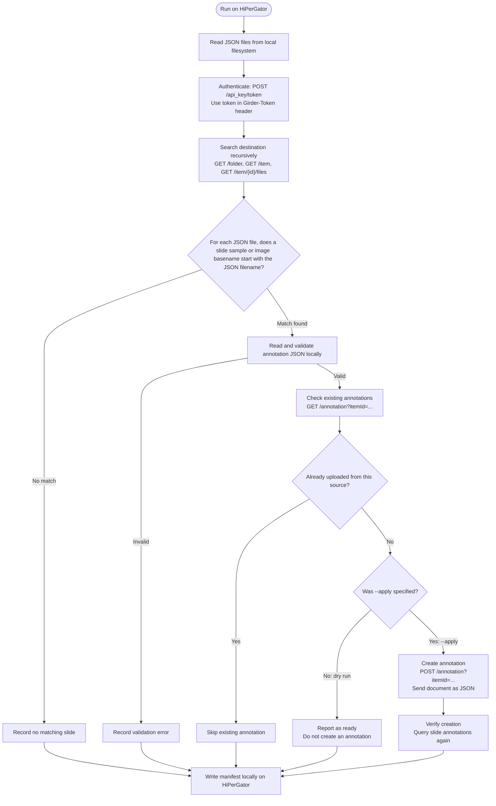

# HiPerGator to Athena annotation transfer

This tool reads JSON annotation documents from a directory on HiPerGator and attaches them to matching whole-slide image items in Athena through its annotation API. It matches each JSON filename to an Athena slide's sample name or image filename without the image extension, then records what it uploaded in a manifest.

## Directory structure

The source directory can be anywhere readable by the machine running the command. Put JSON files directly inside it, or use `--recursive` to include subdirectories.

```text
/path/to/your/annotations/
├── Sample_A_regions.json
├── Sample_A_heatmap.json
├── Sample_B_any_name.json
└── optional-subdirectory/
    └── Sample_C_annotations.json
```

The part after the sample name can be anything. The corresponding Athena destination can be a collection or folder containing the slides, including slides in descendant folders. For example, `Sample_A_regions.json` matches a slide named `Sample_A.svs`, an item with an image file named `Sample_A.tif`, or an item named `Sample_A` with large-image metadata. JSON documents must contain native DSA annotation data: one annotation object, one `{"annotation": {...}}` wrapper, or a list of those objects.

## Run step by step

1. On a HiPerGator node that can read your source directory and connect to Athena, install the tool:

   ```bash
   cd /path/to/HPG-ATHENA-Transfer
   python3 -m venv .venv
   . .venv/bin/activate
   python -m pip install -e .
   ```

2. Provide an Athena API key as `ATHENA_API_KEY` in the environment or in a local `.env` file in the directory where you run the command. For example, create the ignored `.env` file interactively:

   ```bash
   umask 077
   read -rsp 'Athena API key: ' ATHENA_API_KEY; printf '\n'
   printf 'ATHENA_API_KEY=%s\n' "$ATHENA_API_KEY" > .env
   unset ATHENA_API_KEY
   ```

3. Check authentication and access to your destination. Replace the example URL with your Athena collection or folder URL; keep browser URLs in quotes because they can contain `#`:

   ```bash
   hpg-athena-transfer --check-connection --destination 'https://athena.rc.ufl.edu/#collection/YOUR_COLLECTION_ID'
   ```

4. Preview matches and write a manifest. `--dry-run` is the default, so this command does not create annotations:

   ```bash
   hpg-athena-transfer --source /path/to/your/annotations --destination 'https://athena.rc.ufl.edu/#collection/YOUR_COLLECTION_ID' --dry-run
   ```

5. Open `transfer-manifest.json` and review the `sample_name`, `slide_name`, and `status` for each record. Resolve any `unmatched`, `ambiguous`, or `invalid` records. Then upload:

   ```bash
   hpg-athena-transfer --source /path/to/your/annotations --destination 'https://athena.rc.ufl.edu/#collection/YOUR_COLLECTION_ID' --apply
   ```

If interrupted, rerun the same `--apply` command. The tool uses a source path relative to `--source`, hash, and document index in annotation provenance to skip documents already uploaded to that slide. Refresh the matched slide item's **Annotations** panel in Athena to view results.

## Flags

- `--source DIR`: Directory containing annotation JSON files. Required for a transfer; there is no built-in project directory.
- `--destination URL_OR_ID`: Athena collection or folder URL or 24-character ID. Required for a transfer. A URL is best if an ID is ambiguous.
- `--dry-run`: Preview matches and validation without creating annotations. This is the default.
- `--apply`: Create annotations for valid matched files.
- `--recursive`: Include JSON files in source subdirectories. By default, only the top level is read.
- `--manifest PATH`: Write the report to this path. Default: `transfer-manifest.json`.
- `--check-connection`: Check the API key and, if supplied, access to `--destination`; then exit. No source directory is needed.
- `--api-url URL`: Girder API base URL. Default: `https://athena.rc.ufl.edu/api/v1`.
- `--normalize-rgba-alpha`: Convert scientific-notation alpha values in `fillColor` to equivalent decimal notation in the upload payload. Source files are unchanged; the adaptation count is recorded.

## Matching and annotation format

- The tool searches slides in the selected Athena collection or folder and its descendant folders. A slide must have a recognized whole-slide image filename or large-image metadata.
- For each JSON file, remove only its `.json` extension, then compare the beginning of that filename to each slide's sample name: the slide item name or one of its image filenames with the image extension removed. Matching is case sensitive. For example, `Sample_A_review_2026.json` matches `Sample_A.svs`.
- Any remaining JSON filename text is allowed. The suffix does not determine the match. When both `Sample` and `Sample_A` are slide names, `Sample_A_review.json` uses the longest matching name, `Sample_A`.
- If multiple slide items share the selected basename, the file is marked `ambiguous` and skipped. A file with no matching basename is marked `unmatched`. Multiple differently named JSON files may attach to one slide.
- Every valid JSON annotation document becomes a separate entry on the slide. A source annotation's name, attributes, elements, and display settings are preserved. Empty element lists are valid for named native annotations.
- Known filename endings `_heatmap.json`, `_refined_heatmap.json`, `_mask_gt.json`, and `_mask_prediction.json` give the manifest and provenance the labels Heatmap, Refined Heatmap, Ground Truth Mask, and Prediction Mask. All other JSON names receive the generic `Annotation` label. Labels do not control matching.
- The tool adds `annotation.attributes.hpg_athena_transfer` with source filename, relative path, SHA-256 hash, document index, type label, and any color adaptation count. It checks this marker on reruns. It does not replace or delete existing annotations.
- JSON must use native DSA annotation structures. Malformed or unsupported documents are `invalid`. Athena rejects `rgba(...)` fill colors whose alpha uses scientific notation; use `--normalize-rgba-alpha` to convert those values when needed.

## Reports and Slurm

The manifest records source path, matched sample and slide, annotation type, document index, annotation ID, status, and any error. Statuses are `planned`, `uploaded`, `skipped-identical`, `unmatched`, `ambiguous`, `invalid`, and `failed`. A JSON file can contain multiple annotation records. A 401 usually indicates an invalid API key; a 403 usually indicates missing destination access or annotation permission.

To use the included Slurm script, submit from this repository directory and supply your site's account or partition through `sbatch` if required:

```bash
sbatch --account YOUR_ACCOUNT --partition YOUR_PARTITION run_transfer.sh 'https://athena.rc.ufl.edu/#collection/YOUR_COLLECTION_ID' --source /path/to/your/annotations
```

That job is a dry-run. Review `slurm-JOBID.out` and `transfer-manifest-JOBID.json`, then submit again with `--apply`:

```bash
sbatch --account YOUR_ACCOUNT --partition YOUR_PARTITION run_transfer.sh 'https://athena.rc.ufl.edu/#collection/YOUR_COLLECTION_ID' --source /path/to/your/annotations --apply
```

The script uses one CPU, 4 GB RAM, and an eight-hour limit; adjust its `#SBATCH` settings or use `sbatch` options for your workload. It reads the same environment variable or ignored `.env` file as the CLI.

## Tests

```bash
PYTHONPATH=src python3 -m unittest discover -s tests -v
```

# HPG to Athena Annotation Transfer

This program runs on HiPerGator, reads annotation JSON files from its local filesystem, and uses Athena’s Girder API to attach their contents to slides. It does not upload the JSON files as ordinary files in an Athena folder.

## How the transfer works

1. **Authenticate.** The program exchanges `ATHENA_API_KEY` for a Girder token with `POST /api_key/token`. It sends the token in the `Girder-Token` header on later requests.
2. **Find slides.** It searches the destination collection or folder and its subfolders, using `GET /folder`, `GET /item`, and `GET /item/{id}/files`.
3. **Match and validate locally.** For each JSON file, it finds a slide whose sample or image filename, without its extension, starts with the JSON filename. It reads and validates the annotation document on HiPerGator.
4. **Check existing annotations.** It calls `GET /annotation?itemId=...` and skips documents already uploaded from the same source.
5. **Create and verify.** With `--apply`, it sends each new annotation document as JSON to `POST /annotation?itemId=...`, then queries the slide’s annotations again to verify the new record.
6. **Write the manifest.** The transfer manifest is written locally on HiPerGator.

## Dry run and apply

A dry run performs the authentication, destination lookup, local matching and validation, and existing-annotation checks. It does not send an annotation creation request.

Use `--apply` to create new annotations. The program verifies each created record by querying the slide’s annotations again.

## Transfer flow



## Implementation

The API request flow is implemented in:

- `src/hpg_athena_transfer/api.py`
- `src/hpg_athena_transfer/transfer.py`

The tests use synthetic annotations and a mocked Athena API.
